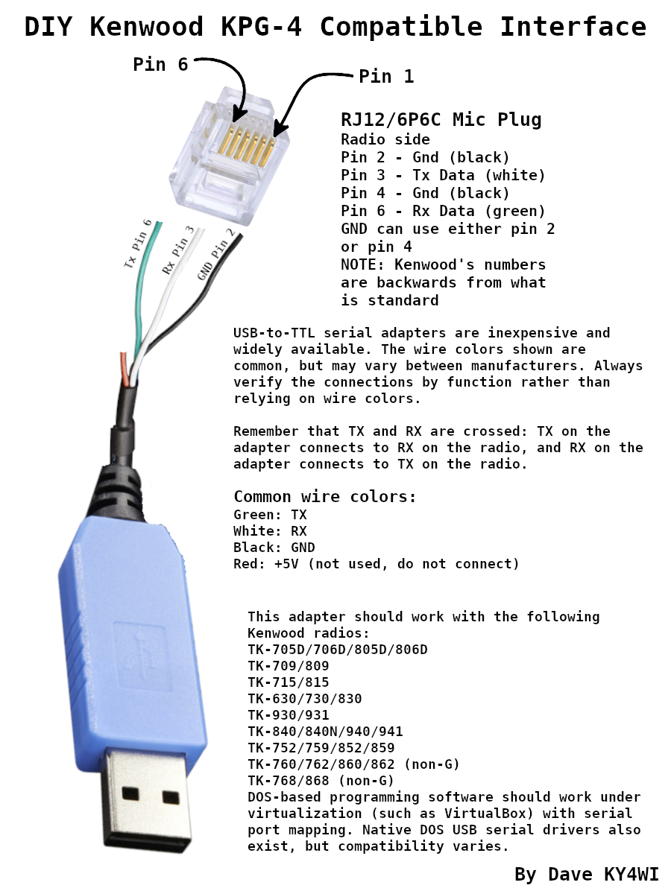

# Kenwood TK-x4x Toolkit

Firmware backup, recovery, diagnostics, and enhancements for Kenwood
**TK-840, TK-940, and TK-941** radios. The **TK-840N** is supported only
for firmware and channel backup/restore.

Current version: **v1.0.0-beta.1**

Copyright (c) 2026 Dave, KY4WI

## What the TK-x4x Toolkit does

The Toolkit can identify your radio, back up and restore its firmware and
channels, recover from interrupted firmware writes, and add useful firmware
enhancements. It guides you through the process before writing to the radio.

The optional **Enhanced TX Patch** and **Enhanced TOT Patch**
extend the radios' original capabilities. Both are explained below.

The Toolkit is **not a channel editor**. Use the
[TK-840/TK-940/TK-941 CHIRP driver](https://github.com/KY4WI/Kenwood_TK-x4x_Chirp_Driver)
for routine channel programming. Until it's included in an official CHIRP
release, you can install the driver separately.

## Getting started

1. Connect the radio and programming cable, then start the Toolkit.
2. Select **1. [G]uided Firmware Workflow** from the main menu (also available through **4. [F]irmware Menu → [G]**). Choose **[R] Read firmware from radio** or **[F] Read firmware from file**.
3. The workflow validates the firmware, reconstructs verified stock, upgrades supported older revisions, and applies recommended patches. If the radio needs an update, it offers a backup before writing.
4. On the final screen, save the prepared firmware to a file, explicitly choose to write it to a radio, or quit without flashing. The individual Firmware Menu actions remain available for manual work.

For an untouched backup of both firmware and channels without running the guided workflow, use **6. Full [B]ackup** on the main menu.

The Toolkit guides you through any required programming modes and power cycles. A backup gives you a recovery point before modifying anything.

### TK-840N: backup/restore only

The **TK-840N is supported only for firmware and channel-data backup/restore in the Toolkit**. Its broader firmware and programming behavior has not been validated.

**Do not use Toolkit firmware patches, firmware transmutation, the Guided Firmware Workflow, or other advanced operations on a TK-840N.** The TK-840N is also **not supported by the CHIRP driver** for channel editing or programming. The firmware and channel backup/restore functions are the sole supported TK-840N operations.

Other TK-840 features and patch compatibility must not be assumed to apply to the TK-840N.

**Can you help validate the TK-840N?** I do not have access to a TK-840N, and that lack of hardware is holding back broader support. If you can loan me one, or are willing to run carefully planned tests on your own radio, please get in touch through the project's GitHub issues or discussions. With access to a radio or reliable hardware-test results, we may be able to validate and support additional TK-840N functions. Until then, the restrictions above still apply. **Do not upload copyrighted Kenwood firmware files or links to them to GitHub.**

## The KY4WI Enhanced Firmware Patches

These optional patches extend the capabilities of supported Kenwood radios. They do not change how you normally program channels. Use the [TK-x4x CHIRP driver](https://github.com/KY4WI/Kenwood_TK-x4x_Chirp_Driver) for channel editing and the Toolkit for firmware updates and patching.

### Enhanced TX Patch

**For conventional channels on a stock TK-940 or TK-941, the radio ignores the programmed TX-frequency field.** Instead, it transmits at a fixed offset from the receive frequency: **-45 MHz on the TK-940** or **-39 MHz on the TK-941**. That complicates simplex and repeater programming, particularly on the 902–928 MHz amateur band. A [TK-941 amateur guide](https://www.kw902.com/941generalinfo.html) describes the awkward workarounds this required.

The old "scan trick" and other fixed-offset workarounds were so cumbersome that, in practice, they could leave you with effectively **one usable repeater channel at a time**, while making it awkward to use multiple simplex frequencies or switch among repeaters. The **Enhanced TX Patch** removes those gymnastics: each conventional channel uses its own programmed TX-frequency field. RX and TX can be set independently for each repeater or simplex channel, and dealer/alignment test transmit also honors its programmed TX value.

Instead of working around a single practical repeater setup, you can make use of **over 300 conventional channels**. The TK-941 supports **up to 308 conventional channels across 32 Systems**, subject to available codeplug space. The **250-channel limit quoted in some guides is a per-System limit, not a radio-wide limit**; multiple Systems share the total capacity.

**Frequency limits:** Patched conventional TX frequencies start at **851 MHz**; patched dealer/test TX frequencies start at **812 MHz**. The patch covers the TK-941's original 896–902 MHz range and the 902–928 MHz amateur band, but **cannot cover the TK-940's original 806–825 MHz TX band**.

**Experimental lower-frequency operation:** In principle, the firmware could be modified to rebase conventional RX and TX frequency encoding to start at 800 MHz. This would change how the stored RX/TX frequency fields are interpreted, requiring corresponding changes to programming software such as CHIRP and conversion of existing channel data. The standard Enhanced TX Patch deliberately retains the original 851 MHz channel encoding; lower-frequency rebasing is not supported. Actual usable frequencies would still depend on the radio's RF hardware. Anyone with a specific legitimate application, such as a transverter, is welcome to contact the author.

**LTR trunking is not changed.** On stock TK-940/941 conventional channels, Talk Around forces TX to the RX frequency. With Enhanced TX, the conventional Talk Around flag no longer changes TX frequency and can be used as a visual TA marker on the display, although enabling it still introduces approximately 36 ms of key-up delay. LTR channels keep their original functional Talk Around behavior. The CHIRP driver edits conventional channels only, not LTR channels.

The **TK-840 already honors its programmed TX-frequency field**, so it does not need the Enhanced TX Patch.

#### Important: Check TX frequencies after patching

**Reprogram the TX frequency of every channel you intend to transmit on.** The stock TK-940/941 firmware ignored the TX field, so existing values may be wrong or meaningless. Do not transmit until the RX and TX programming has been verified.

For simplex, set TX equal to RX. In CHIRP, **Duplex: off** selects receive-only operation; on upload the driver also enables the separate **TX Inhibit** setting. If you later make the channel transmit-capable, check TX Inhibit under the channel's Extra settings.

### Enhanced TOT Patch

The built-in **Transmit Time-out Timer (TOT)** limits continuous transmission. The standard Dispatch TOT settings range from **15 seconds to 10 minutes**, in 15-second steps, but stock firmware does not offer Off.

The **Enhanced TOT Patch** adds **Off** while preserving all existing timed settings. This can be useful when the radio is used as a repeater transmitter. It changes **Dispatch TOT only**; **Telephone TOT is unaffected**.

To select Off, use the [TK-x4x CHIRP driver](https://github.com/KY4WI/Kenwood_TK-x4x_Chirp_Driver). Kenwood's original programming software does not offer that option. The setting is a **global radio configuration value**, not a per-channel option. The Enhanced TOT Patch interprets the stored value `0xFF` as Off; **stock firmware interprets that value as a one-minute timeout**, not Off. Only select Off after confirming the Enhanced TOT Patch is installed.

The Enhanced TOT Patch has been hardware-tested on **TK-840 firmware 8355 and 9306**, and **TK-940/941 firmware AB00**.

### Older firmware modifications

- **Historical +25 MHz Offset Patch:** Substitutes a fixed +25 MHz TX offset on TK-940/941 radios. Like stock firmware, it still ignores each channel's programmed TX-frequency field. Enhanced TX supersedes this workaround by allowing independent RX and TX programming.
- **Legacy TOT Bypass:** Disables the timer unconditionally rather than adding an Off choice. Enhanced TOT supersedes this approach because you can still select a normal timeout when desired.

The original +25 MHz offset and TOT patches were developed by **Neal, KB5ERY (SK)**. Credit for those earlier modifications belongs to him.

The Toolkit recognizes supported historical modifications and offers suitable removal or replacement operations. Existing patches are checked before changes are made; unknown firmware or unrecognized modifications are not patched.

## Supported radios and firmware

The patchable models below are the TK-840, TK-940, and TK-941. **TK-840N is backup/restore-only**, as explained above.

| Radio and firmware | Available enhancements |
| --- | --- |
| TK-840 8355 | Enhanced TOT Patch (hardware-tested) |
| TK-840 9306 | Enhanced TOT Patch (hardware-tested); optional conversion to stock 8355 (hardware-tested) |
| TK-940 / TK-941 AB00 | Enhanced TX Patch, Enhanced TOT Patch, or both |
| TK-940 / TK-941 2CCA, 8E9D, B5EC | Enhanced TX Patch; may convert to stock AB00 before adding Enhanced TOT |

Firmware patching is limited to recognized revisions. The Toolkit can **Validate / Transmute Firmware [T]** to convert supported older TK-940/941 firmware to verified stock AB00, or TK-840 9306 firmware (including recognized TOT-patched versions) to verified stock 8355. The **9306 → 8355 conversion has been tested successfully on a real radio**.

Transmutation verifies the firmware and changes the **loaded image in memory**. It does not write the result to the radio unless you explicitly start a write. Save your original firmware before converting or patching.

The **TK-840N is limited to firmware and channel backup/restore with the Toolkit**; firmware enhancements, transmutation, and CHIRP programming are unsupported. For firmware history and technical details, see [Firmware revision references](docs/Firmware_Revisions.md).

## Other features

- **Quick Probe:** Identifies the connected radio and checks its firmware revision and known patch status without a full firmware download. The main status screen distinguishes **Loaded in Memory** from **Connected Radio**. A revision labeled `fingerprinted` has been identified by a small read; it does **not** mean the complete firmware is loaded. Loading or modifying a firmware file does not change the radio until it is written.
- **Memory jogger:** Quick Probe, Read Firmware, Read Channels, and Full Backup show a preview of up to ten channels from the physical radio to help you recognize which radio is connected. Firmware operations sample channel records; channel reads and backups use data already retrieved. A preview is **not** a complete channel load, and file-only operations do not show a radio preview.
- **Backup and restore:** Saves firmware, channel configuration, or both in a full backup.
- **Firmware and channel read/write:** Guided operations with appropriate verification. The Firmware Menu reads and writes raw binary firmware (default `.bin`) or Kenwood Intel HEX (default `.hex`). Older `.tk4firm` and `.tk4back` binary files remain readable. HEX input is checked for valid records, addresses, and checksums; HEX output uses Kenwood-style records and DOS CRLF line endings.
- **Validate / Transmute Firmware:** Validates supported images by full SHA-256, removes recognized modifications to recover verified stock firmware, or converts supported older revisions to verified stock firmware. Changes stay in memory until you explicitly write them. Unknown revisions or unrecognized modifications are refused.
- **Firmware recovery:** Recovers radios from interrupted or unsuccessful firmware writes when the resident loader is accessible.
- **USB programmer detection:** Helps identify the correct serial port by monitoring the USB adapter being disconnected or connected. Manual selection is also available.
- **Advanced tools:** Development firmware mode, mask-ROM dumping, and command-line operations for experienced users.

## Programming cable

A DIY KPG-4 programming interface can be built using a USB-to-TTL serial
adapter. A wiring diagram is provided below.



**3.3 V adapters:** A USB-to-TTL adapter using 3.3 V logic should also work
if its RX input is 5 V tolerant. I've successfully used a 3.3 V adapter
with four different radios. Check the adapter's RX voltage tolerance
before connecting it.

## Firmware safety

An interrupted firmware write can leave the radio temporarily unable to
boot, but the permanent mask-ROM loader usually allows recovery. Keep a
known-good backup and verify the firmware you plan to write. The Toolkit
allows advanced writes, including potentially incompatible images, so
you remain responsible for choosing the correct firmware.

The sections below explain the recovery protections and technical details.
Most users can stop here and run the Toolkit.

## Interface and command-line reference

### Interface

The minimum supported terminal size is **80x24**; **80x30 or larger is recommended**.

For a first-time firmware update, select **1. [G]uided Firmware Workflow** on the main menu. **3. [Q]uick Probe Radio** remains available for a quick identification check without a full download. A radio-sourced guided update reads the complete firmware once and offers a backup if an update is needed; channel data is read only if the combined backup is selected. **6. Full Backup** remains available independently.

In the main menu, items can be selected by their number or bracketed letter shortcut. Arrow keys move the selection, and Enter or Space activates it. On ANSI-capable terminals and native Windows consoles, including Windows 2000/XP, the selected item has a `>` marker and inverse-video highlighting. Plain-text mode retains the `>` marker without ANSI sequences.

Each interactive menu provides a brief description of the selected item. Press `X` in a menu to switch to plain-text mode for the session; `--no-ansi`, `--plain-text`, or `-p` starts that way.

`Esc` normally means Back or Cancel. File and serial-port selectors return to their calling menu rather than exiting the program; the file browser also supports `B`, `Q`, and `E` for backing out. Only an explicit Exit action quits the program. The binary file browser shows firmware images only when the file size is exactly **26,112 bytes** (`0x6600`) or a full firmware/channel backup is exactly **32,256 bytes** (`0x7E00`). Files of other sizes are hidden. Binary files are filtered by size, not by extension, so a correctly sized file does not need to end in `.bin`. The HEX browser instead lists `.hex` files by extension and validates their contents when opened.

The selected programmer port is shown in the status area. On Linux, the status display omits `/dev/` for readability, but manual entry accepts `ttyUSB0` or `/dev/ttyUSB0`. Windows ports appear as `COM3`, for example.

**Firmware and Channels both provide these basic operations:**

- `[R] Read from Radio`
- `[W] Write to Radio`
- `[F] Read from File` and `[S] Write to File`
- `[B] Back` and `[Q] Exit`

The **Guided Firmware Workflow** is available as **1. [G]uided Firmware Workflow** on the main menu and as **[G] Guided Firmware Workflow** in the Firmware Menu, which also offers individual read, write, validate/transmute, and patch functions. The guided workflow starts by reading firmware **from radio** or **from file**; both sources can subsequently save to **file and/or radio**. The radio path reads the complete firmware once and offers a backup only if an update is needed. The file path does not access the radio until **[W] Write Prepared Firmware to Radio** is selected; it then reads the target radio's complete firmware, verifies model compatibility, and offers a backup if an update is needed. The output menu also provides **[S] Write Prepared Firmware to File**, with separate BIN or HEX choices. Select **[Q] Quit** to leave the radio unchanged. Unsupported revisions or unrecognized modifications abort guided preparation.

**BIN is the recommended firmware format.** Kenwood Intel HEX is retained primarily for compatibility with the original Kenwood software. The Firmware Menu also offers separate **Read from BIN File**, **Read from HEX File**, **Write to BIN File**, and **Write to HEX File** operations for manual work. The Channels Menu uses its own channel-file actions. Firmware images come from the radio or user-supplied files; Kenwood firmware is not included in this repository.

### Quick Probe

Quick Probe identifies the connected radio with a small read instead of downloading its complete firmware and channel configuration. Depending on the radio and recognized firmware, it reports:

- Radio model and programming ID
- Firmware revision identified by fingerprint
- Programming-password state (and recovered password, if applicable)
- Known Enhanced TX, Enhanced TOT, or historical patch status
- Firmware-loader access state
- A **Memory jogger** preview of up to ten available channel names and RX frequencies

The Memory jogger appears in the results of radio probe/read/backup operations, not in the persistent menu status. A sampled preview is not represented as loaded channel data. Read Channels or Full Backup loads the full channel dataset into memory.

If the radio is already in normal, non-flashing `PROGRAM` mode, the Toolkit can retry the connection without requiring a power cycle.

### USB programmer detection

USB detection helps users who don't know which serial port their programming
cable uses. Start detection, then follow the prompts to unplug and/or plug
in the adapter. The Toolkit watches for changes and probes candidate ports
for a responding Kenwood radio. You can also select a port manually.

Experienced users can bypass detection and enter the port manually at any time. If no USB serial ports are present, the selector explicitly reports that no ports were detected and offers Retry, manual entry, USB detection, or Back instead of silently returning.

### Command-line use

Launch the same **Guided Firmware Workflow** directly from the terminal with:

```sh
./tkx4xtoolkit guided
```

This skips the main and Firmware menus, then asks whether to start with the radio or a file. It uses the **same** interactive preparation, optional save, and optional radio-write workflow as Main Menu **[1]** and Firmware Menu **[G]**. The command also supports `--no-ansi`, `--port`, and `--backup-dir`; input, output, and patch selections remain within the workflow.

The Toolkit also supports individual command-line operations for reading, writing, backing up, restoring, and patching. Commands that need radio interaction use the same prompts, port/file selection, power-cycle instructions, and verification procedures as the menus. The current CLI does not provide an unattended firmware-writing mode.

The `firmware-loader-write` command writes the full firmware through the resident mask-ROM loader **without reading installed application firmware first**. This is intended for recovery and other situations where the normal application cannot be read.

For recognized firmware, `--patches tx|tot|both` selects enhancements. On TK-840, the default is TOT. On TK-940/941 AB00, the Toolkit offers a guided selection; other recognized TK-940/941 versions support Enhanced TX. Enhanced TOT applies to TK-840 8355/9306 or TK-940/941 AB00. These restrictions do not prevent separate direct firmware writes or development-mode operations.

Run `tkx4xtoolkit --help` for the complete command and option reference.

## Technical information

### Data, files, and backups

Raw data sizes are:

- Firmware: `0x6600` bytes (`0x8000-0xE5FF`)
- Channels: `0x1800` bytes (`0xE600-0xFDFF`)
- Full backup: `0x7E00` bytes, firmware followed by channels

Binary firmware, channel, and full-backup files use **`.bin`** by default; they are distinguished by their names and their exact binary sizes. For example:

- `TK-941_FW_AB00_ETX_ETOT.bin` - firmware with both recommended enhancements
- `TK-840_FW_8355_ETOT.bin` - firmware with Enhanced TOT
- `TK-941_FW_AB00_STOCK.bin` - SHA-256-verified stock firmware
- `TK-941_CH.bin` - channel information
- `TK-941_FULLBACKUP.bin` - combined firmware and channel backup

The generated firmware filename reflects the **loaded image**, not the previous source filename. `ETX` and `ETOT` represent verified Enhanced TX and Enhanced TOT patches. `STOCK` is reserved for exact stock-image SHA-256 matches; other images may be marked `MOD`, `LEGACYTOT`, or `UNVERIFIED`. All suggested filenames remain editable.

Binary input is recognized by its size and contents, not by its filename extension. Full backups can also supply just their firmware or channel portion.

If the selected firmware write operation and a typed `.bin` or `.hex` extension disagree, the Toolkit asks whether to write **BIN** or **HEX**. **Enter** accepts the format indicated by the filename; `H` or `B` explicitly chooses a format; **Esc** returns to filename editing with the existing name preserved. The Toolkit never silently changes a filename or extension, even if the chosen format disagrees with it. Other extensions are kept as entered, with no extra prompt.

Automatic backups default to the `backups` directory and use timestamped `.bin` filenames. The directory can be changed under Advanced / Special Options.

### Programming modes and firmware recovery

The radios have two programming paths:

- **Normal PROGRAM mode** runs in application firmware. It can read memory and write channel/configuration data, including the setting that enables access to the firmware loader. It cannot write application firmware.
- **Firmware loader mode** runs from permanent CPU mask ROM. It programs application firmware in flash ROM; reflashing cannot erase the loader itself.

In short, **the mask-ROM loader programs firmware, and the running firmware programs settings**. Normal firmware updating checks that loader access (bit `0x04` at `0xE66C`) is enabled before writing. Firmware writes normally compare 64-byte pages with the existing image and write only changed pages; advanced options can force a complete write.

To enter firmware loader mode:

> Turn radio off. Hold SYS-UP, hit power, and release SYS-UP. In a few seconds, it will flash "PROGRAM".

The Toolkit provides an explicit abort choice while the radio is waiting in flashing `PROGRAM` mode, before any destructive write begins. If readback verification cannot start because the radio remains in loader mode, power-cycle normally when prompted and retry verification. A real byte-for-byte mismatch is reported separately and can be retried.

### What are the chances of bricking my radio?

**With functioning hardware, a normal firmware write cannot create a software-only hard brick.** The loader is permanent, and firmware updates cannot change the configuration setting that grants access to it. Even an interrupted or corrupted application write can normally be recovered by reflashing.

Flash writes also require the hardware `P37/WRPRO` gate. Without that gate, flash erase/program commands cannot change flash contents.

A genuine software-induced hard brick requires **both** unusable application firmware and disabled loader access. That combination could be deliberately created by modified custom firmware that changes configuration and then becomes unusable, but it is not produced by normal firmware writing. See [hard-brick recovery documentation](https://github.com/KY4WI/Kenwood_TK-x4x_Reverse_Engineering/blob/main/docs/TK-x4x_Hard_Brick_Recovery.md) for the hardware recovery procedure.

Keep a backup, verify the firmware you intend to write, and use the Toolkit at your own risk. The operator remains responsible for the radio's configuration and lawful operation.

### Firmware patch technical details

Firmware patching requires recognized firmware revisions. **The recommended update path is Main Menu → Guided Firmware Workflow.** Quick Probe identifies recognized firmware by a SHA-256 **fingerprint** of block `DF00-DF7F`, which is unchanged by the known patches. Full firmware reads and file loads validate the complete image before normalization or patching. The actual instructions at known patch sites are checked; unknown or mixed/unrecognized firmware is never patched by the guided workflow.

| Recognized firmware | Available patches |
| --- | --- |
| TK-840 8355 / 9306 | Enhanced TOT Patch |
| TK-940 / TK-941 AB00 | Enhanced TX Patch, Enhanced TOT Patch, or both |
| TK-940 / TK-941 2CCA, 8E9D, B5EC | Enhanced TX Patch; transmute to AB00 for Enhanced TOT |

The **Enhanced TX Patch** checks both conventional and dealer/alignment TX routines within the recognized TK-940/941 revisions. **Enhanced TOT** matches exact revision-specific bytes at fixed addresses: three regions on AB00 or two on TK-840 8355/9306. It does not scan for similar code and relocate it. Recognized historical modifications are distinguished from the new patches; an incomplete or unexpected sequence is rejected rather than guessed at.

The 8355 and AB00 timer-setup replacement bytes are identical, but their conventional countdown routines have different beep callback targets (8355 `C639`; AB00 `C2DC`). AB00 also patches a third timer path; the validated TK-840 conventional-mode patch modifies two.

**Enhanced TOT validation:** The TK-840 8355 patch passed a 10x accelerated timer test: a programmed 15-second timeout expired after 1.5 seconds, and six minutes of continuous transmission with TOT Off did not time out. Enhanced TOT on TK-840 9306 and TK-940/941 AB00 has also been hardware-tested. With the patch, Dispatch TOT `E662=FF` means Off; stock firmware treats that as a 60-second fallback. Other timer settings retain their behavior, and Telephone TOT is unchanged. Set an explicit timeout after patching if the existing Dispatch TOT byte is already `FF` and you do not want Off.

The historical AB00 unconditional TOT bypass (`B1AE: 81 01 -> 00 00`) is identified separately. The Guided Firmware Workflow reports and removes recognized legacy modifications as part of its verified stock normalization, before applying the recommended enhancements. Unknown modifications cause the workflow to stop. A firmware write is not considered complete without the selected verification.

#### Optional firmware identification marks

The Toolkit can write two independent identifiers into otherwise unused firmware space. **Neither is required for the patches themselves to work:**

- **Author signature:** `KY4WI FW MODS  ` at `0xE5D0`. Disable it with **[S] Include author signature** under Advanced / Special Options, or `--omit-author-signature`.
- **Patch-flags byte:** Optional metadata at `0xE5DF` (prefix `0x80`; bit 0 Enhanced TOT, bit 1 Enhanced TX, bit 2 reserved). Disable this mark with **[C] Include firmware patch flags** or `--omit-chirp-tag`.

**Keeping the patch-flags byte is recommended**, because it provides useful identifying metadata for the Toolkit and CHIRP. However, **CHIRP does not rely on this byte to determine the actual patch state or to allow TX-field editing**. For recognized firmware, CHIRP independently checks the firmware fingerprint and known patch bytes; the stored TX field is not necessarily what stock TK-940/941 firmware transmits. Missing or conflicting metadata does not override byte-verified patch identification.

Identification marks are written only into erased (`FF`) space or over a matching existing mark. Unrecognized bytes are preserved. Disabling either or both marks does not disable the firmware enhancements.

#### Guided Firmware Workflow backups and preparation

When starting **from the radio**, the workflow reads the **entire original firmware first**. If an update is needed, it offers these backup choices:

- `C`: Original firmware plus channel information (recommended)
- `F`: Original firmware only
- `N`: No backup

The channel data is read only if the combined backup is requested. The backup contains the **original firmware**, not the normalized or patched result.

When starting **from a file**, the workflow makes no radio connection during preparation. If the operator later explicitly chooses **Write Prepared Firmware to Radio**, it reads the target radio's complete existing firmware and validates compatibility. If an update is needed, it offers an original-radio backup before writing.

In either case, guided preparation reconstructs and verifies known stock firmware, transmutes to the recommended supported revision, and applies the recommended enhancements. **The guided workflow always prepares TK-840 firmware 8355 with Enhanced TOT or TK-940/941 firmware AB00 with Enhanced TX and Enhanced TOT.** It does not offer separate version or patch selections, and it does not flash anything until you choose **Write Prepared Firmware to Radio**. It stops if a required check fails. The final screen lets you save the prepared firmware, write it to a radio, or quit. Use the separate Validate / Transmute Firmware and Firmware Patches operations if you want to keep an older revision or choose enhancements individually.

#### TK-840 alternate timer path

Analysis of 8355 firmware found another `FE40` countdown at CPU `DA71`, gated by `FE78.7`. The surrounding 40-byte sequence at `DA61` matches the third TOT region of TK-940/941 AB00. The hardware-tested TK-840 patch intentionally changes only the conventional timer setup and countdown; **the alternate path is not modified, and its reachability in other operating modes has not been established**. This limitation is separate from the successful 8355 and 9306 Enhanced TOT hardware tests.

### Development firmware mode

#### Purpose and safeguards

**Development firmware mode** in Advanced / Special Options is for quickly testing custom firmware. It writes through the resident loader without first reading the complete installed firmware, since experimental firmware might not implement normal PROGRAM-mode reads. It requires loader access; the Toolkit refuses development mode if it already knows that access is disabled.

#### Remembered firmware baseline

Development mode keeps **one** baseline across sessions at `backups/development-baseline.dat` (or in the configured backup directory). It tracks which 64-byte flash pages are known and their last confirmed contents. Full reads and successful writes update that baseline. You may manually load a baseline file or forget it from Advanced / Special Options.

**There are no per-radio profiles.** Do not assume the saved baseline belongs to another radio, even of the same model. Uncertain/partial writes quarantine the previous baseline under `.uncertain` instead of trusting it.

Quick Probe compares up to three widely spaced 128-byte samples against the remembered baseline. On a mismatch, the Toolkit clears the in-memory baseline and warns, while leaving the saved file available for investigation. Matching samples **do not prove the full firmware is identical**. A previous-session baseline not checked during the current session requires an additional confirmation before use.

#### When only some pages are known

Without a baseline, development mode writes through the last non-`FF` page before the fixed `KENWOOD` signature area and then writes two erased `FF` guard pages. It does not write the unchanged signature page merely because the signature exists. Other untouched pages remain **unknown**, not assumed erased.

As later builds grow, newly occupied pages are written; when they shrink, known pages that should become `FF` are cleared. Writing **75% or more** of firmware pages requires an extra confirmation. Unused space in custom linked firmware should be padded with `FF`, not zeros.

#### Write completion and verification

When all pages are known, the Toolkit can calculate the exact expected firmware checksum. If unknown untouched pages remain, it does not guess a checksum and instead asks whether the radio displays its four-digit checksum after writing.

Development mode intentionally skips normal-mode firmware readback verification because experimental firmware may not support it. **Completing the serial transfer does not establish that flash programming succeeded.** Confirm the radio's displayed checksum; there is no automatic transfer timeout.

After a serial-port error, the Toolkit clears cached radio connection details but keeps the selected port name, so reconnecting the same USB adapter should not require selecting it again.

### Mask ROM dump

Advanced / Special Options also includes **Dump mask ROM**. It reads the CPU's internal mask ROM through normal PROGRAM mode and saves the raw image in the backup directory.

The mask ROM is **8 KiB at `0x0000-0x1FFF`**. The unused/open address space from `0x2000-0x7FFF` is deliberately not dumped.

Successful dumps report the exact address range, byte count, and SHA-256 digest. The output filename includes the radio model, size, and a short digest prefix.

## Development validation

GitHub Actions builds the program on Linux and runs non-hardware CLI smoke tests. To run similar checks locally on Linux:

```sh
make plain
./tkx4xtoolkit --version
./tkx4xtoolkit --help
```

These automated checks catch build and command-line regressions; they do not test physical serial communication. **The supported firmware programming, recovery, and identified patch workflows have been tested on real hardware.** Experimental and unsupported model-specific behavior still requires separate validation.

## Kenwood firmware and copyright

Kenwood firmware is copyrighted and is **not** distributed with this project. Firmware used by TK-x4x Toolkit is read from the connected radio or supplied by the user. Do not upload Kenwood firmware files, or links to them, to this repository, including issues or discussions.

## Legal and operating responsibility

TK-x4x Toolkit can modify radio configuration and firmware and may allow a radio to be programmed or operated outside its original configuration. You are responsible for ensuring that your radio and its operation comply with all applicable laws, regulations, license conditions, frequency allocations, emission requirements, and equipment-authorization requirements.

In the United States, the applicable rules may include FCC Part 90, Part 97, or other rules depending on the radio service and how the radio is used. Equipment-authorization requirements vary by service. The fact that a radio can be programmed for a particular frequency or service does not mean that its use there is legal or authorized.

The Enhanced TX Patch changes how the radio derives its transmit frequency. It does not determine whether a programmed transmit frequency is legal for the operator or radio service.

Use this software at your own risk. The author assumes no responsibility for loss of data, equipment damage, interference, regulatory violations, or other consequences resulting from its use.

## Project history

This project started as a CHIRP driver for the TK-840. It grew through `tk840download`, `tk840upload`, and `tk941patch`, and eventually became TK-x4x Toolkit.

One reason the Toolkit became a separate project is that firmware updating and firmware modification are outside the scope of what normal CHIRP drivers are allowed to do. The Toolkit provides those firmware, recovery, diagnostic, backup, and patching functions separately, while CHIRP remains the right tool for routine channel editing.

A substantial amount of reverse engineering, firmware analysis, programming, hardware testing, and experimentation has gone into this project. I do not own a TK-941; much of this work was done to help the amateur-radio community make these radios more useful.

## Ideas for possible future improvements

**Future feature-bit interpretation (proposal, not implemented):** Treat bit 1 as a *capability*, meaning **conventional transmit honors the programmed TX-frequency field**, rather than specifically indicating that the Enhanced TX Patch was applied. That capability is already present in stock TK-840 firmware, so the Toolkit would also set bit 1 when it adds metadata to a TK-840. On TK-940/941, bit 1 would indicate the corresponding patched conventional TX behavior. **This would not change LTR operation:** LTR on TK-940/941 retains its stock fixed-offset behavior. The distinction is intentional because the proposed flag describes conventional TX only. CHIRP and Toolkit would need to agree on this revised meaning before it is enabled.

These are ideas under consideration, not a development roadmap or commitments:

- **EEPROM calibration backup/restore:** A possible future feature to preserve radio-specific calibration data.
- **Optional CHIRP metadata in Toolkit channel files:** Include model identification so CHIRP can open exported channel images without having to infer the radio model. This would require extending the Toolkit's current fixed-size file handling.
- **PLL lock-range diagnostics:** With suitable custom firmware support, sweep receive and transmit frequencies to characterize where a particular radio's PLL actually locks.

## Optional 10x timer test (advanced users only)

An optional **10x accelerated Dispatch TOT test** is available for experienced users who want to examine the Enhanced TOT Patch. It requires making a separate, manually edited test firmware image and **must not be used for normal radio operation**.

The full procedure, including exact byte changes, addresses, safeguards, and restoration instructions, is in the [10x TOT test guide](docs/Enhanced_TOT_10x_Test.md).

The [TK-x4x CHIRP driver](https://github.com/KY4WI/Kenwood_TK-x4x_Chirp_Driver) can identify this exact test modification. When detected, its Dispatch TOT dropdown shows the **normal programmed timeout** followed by the **actual 10x timeout**, such as `3:00 (10x: 18 sec)`, and displays a prominent warning. With normal or unverified firmware, CHIRP shows ordinary timeout values only. The stored timer configuration is unchanged. Re-download the radio configuration after reflashing to refresh the firmware status saved in a CHIRP image.

## Building from source

Prebuilt releases contain ready-to-run executables rather than source code. To compile the Toolkit, get this repository or the corresponding GitHub source archive and see [BUILDING.md](BUILDING.md).

Development builds identify the Git commit (and indicate uncommitted changes with `-dirty`); official release executables omit that identifier.

## Release downloads

The project provides separate archives for Linux (x86_64 and static 32/64-bit builds), Windows (32/64-bit), and macOS (Intel and Apple silicon). Choose the archive matching your operating system and CPU. Each archive contains the Toolkit executable, a plain-text `README.txt`, `LICENSE`, and `SHA256SUMS` for checking the executable.

Linux/macOS packages use `.tar.gz` and Windows packages use `.zip`. Each archive includes the version, platform, and architecture in its filename. Inside, the executable is versioned without a platform suffix: `tkx4xtoolkit-v1_0_0-beta_1` on Linux/macOS and `tkx4xtoolkit-v1_0_0-beta_1.exe` on Windows. The local build filenames are unchanged. If the remote Mac is unavailable during `make dist`, five Linux/Windows archives are produced with a warning; Mac build errors still fail the build. Source archives are provided separately through GitHub.

Release maintainers: the exact archive filenames, packaging instructions, and publishing checklist are in [BUILDING.md](BUILDING.md).

## Main project files

- `tkx4xtoolkit.c`: Main Toolkit application and interface
- `fwtransmute.c`, `fwtransmute.h`: Firmware validation, normalization, and revision conversion
- `fwgrimoire_tk840_9306_8355.h`: TK-840 9306-to-8355 conversion data
- `firmware_hex.c`, `firmware_hex.h`: Intel HEX firmware support
- `tkx4x_plus25_patch.h`: Historical +25 MHz patch identification/removal data
- `Makefile` and `BUILDING.md`: Build targets and release procedures
- `tools/package_release.py`: Release archive creation and README text conversion
- `README.md`, `docs/`: Usage and technical documentation
- `DIY_KPG-4_Programming_Interface.png`: DIY programming interface diagram
- `mac-credentials.mk.example`: Example remote macOS build settings
- `tests/`, `.github/workflows/ci.yml`: Automated non-hardware tests and GitHub Actions workflow
- `LICENSE`: GPLv3 license

Project: https://github.com/KY4WI/Kenwood_TK-x4x_Toolkit

## AI Assistance

AI tools were used to assist with the development of this project, including code, research, and documentation. However, that should not be mistaken for AI doing all the work. I established the goals, directed the development, made the design decisions, and spent considerable time reviewing, testing, correcting, and refining the results.

AI can be an incredibly useful tool, but getting good results requires technical knowledge, persistence, and a great deal of hands-on work. Sometimes working with AI feels like typing with boxing gloves on.

This is very much my work, developed with the assistance of AI, not a project independently created by it.
